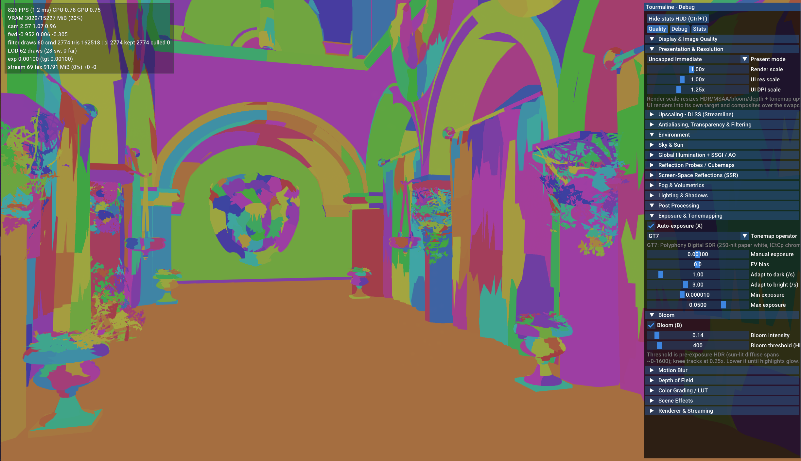
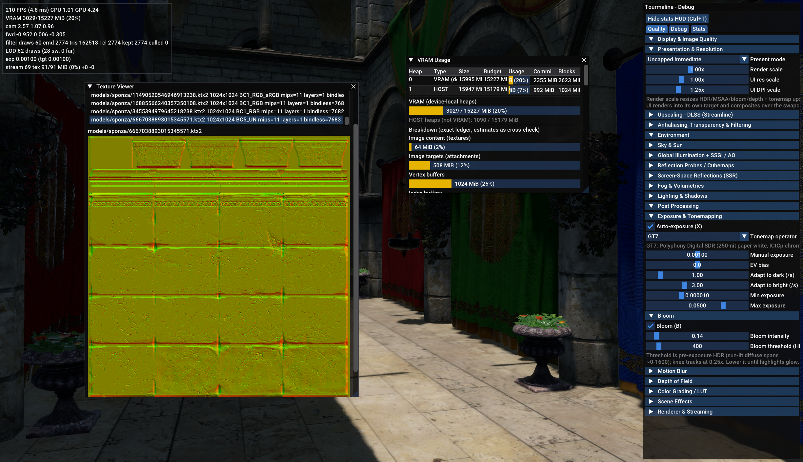
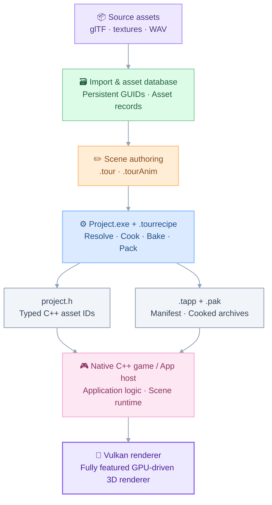

<picture>
  <source
    media="(prefers-color-scheme: dark)"
    srcset="branding/tourmaline-logo-horizontal-dark.png"
  >
  
</picture>

[](https://github.com/striker-samuel/tourmaline/actions/workflows/ci.yml)
[](https://github.com/striker-samuel/tourmaline/actions/workflows/tests.yml)

**A rendering and content framework for C++20 applications, built on Vulkan 1.3.**

Tourmaline provides an opinionated GPU-driven renderer, a scene and asset pipeline, and the runtime infrastructure needed to bring authored content into native applications.

**Bring your own code.** Tourmaline doesn't prescribe a gameplay framework, ECS, scripting language, or application architecture. Write your application logic in C++, own your objects and their lifetimes, and use the parts of Tourmaline that make sense for your project.

Scenes are authored through a human-readable `.tour` command format with references and non-destructive overrides. Project recipes cook source assets into packaged `.pak` archives and generate a C++ `project.h` catalog, allowing applications to reference content through stable, typed identities rather than hardcoded file paths.

Tourmaline includes a Vulkan render graph, GPU-driven mesh rendering, clustered Forward+ lighting, animation and audio runtime services, content tooling, and an experimental editor.

The framework is under active development. APIs and asset formats are evolving, and several subsystems remain experimental. See [implementation status](docs/implementation_status.md) for source-checked features and integration boundaries.

## Highlights

- **Vulkan renderer:** Custom resource management, bindless descriptors, render graph, GPU synchronization, and HLSL shaders compiled to SPIR-V with DXC.
- **GPU-driven geometry:** Hierarchical-Z occlusion, GPU culling/filtering, meshlets, LOD chains, skinning, and geometry/texture streaming paths.
- **Lighting and effects:** Clustered Forward+ lighting; directional, spot, EVSM, and experimental deferred shadows; SSR, ambient occlusion, volumetrics, exposure, bloom, depth of field, motion blur, and SMAA. Optional DLSS-SR/Reflex integration is available on supported Windows/NVIDIA setups.
- **Authored worlds:** A Maya-inspired, text-based `.tour` scene overlay with references, overrides, editable nodes, and replayable operations. `.tourAnim` provides skeletal clips.
- **Content as code:** `Project.exe` resolves `.tourrecipe` builds, cooks and verifies multiple `.pak` files, publishes a `.tapp` runtime manifest, and generates a typed, `constexpr` `project.h` catalog of persistent asset IDs.
- **C++-first runtime:** Scene loading by asset ID, additive scene instances, asset prefetch, typed generational handles for mesh instances/animators/audio emitters, and scene-aware spatial audio. Game code owns the gameplay objects.
- **Editor and offline tools:** An ImGui scene editor plus command-line import, cooking, GI baking, packaging, asset inspection, and debugging tools. The editor also offers a full-renderer baked-GI view and fallback inspectors for unrecognized files. Scene physics-body/collider authoring and serialization exist, but Jolt simulation is not automatically instantiated from authored bodies.
- **Optional shared asset repository:** Run an offline/local or Windows/Linux NAS-hosted source history service, publish separate immutable asset representations, use verified Maya caches, and inspect advisory consumer read-presence without file locks. See [Asset repository manual](docs/asset_repository_manual.md).
- **Repeatable benchmarks:** A standalone `Benchmark` target, in-viewer scenario export to a source-controlled catalog, a Python A/B performance harness, and optional NVIDIA Nsight Graphics trace/capture workflows.

## Screenshots

GPU-driven meshlet debug view:



Renderer inspection and debugging panels:



*These captures use the Sponza demonstration scene. Its cooked content is not committed to the repository — it ships as a one-command download from the [demo-content release](https://github.com/striker-samuel/tourmaline/releases/tag/demo-content) (see [Demo content](#demo-content-sponza)).*

**Sponza attribution:** The model is Crytek-derived, with upstream contributions by Frank Meinl, Marko Dabrovic, Morgan McGuire and Alexandre Pestana. See [Sponza credits and license status](SPONZA-CREDITS.md).

The optional [asset repository](docs/asset_repository_manual.md) manages working source revisions and published representations **before** cooking. It is deliberately separate from the project catalog: `project.h` describes **cooked build content** and does not track source/product versions or client read activity.

## How it fits together

Tourmaline separates **authoring**, **content builds**, and **game execution**. Content does not need to be cooked by launching the editor.



A checked-in `.tourrecipe` declares entry scenes, package ownership, cross-pak dependencies, and GI/cubemap bake switches. The pipeline resolves those dependencies, validates outputs, and publishes content-addressed pak files with a runtime manifest. Stable content IDs come from the project's asset database and asset GUIDs, rather than being derived from paths.

The generated `project.h` contains typed asset keys, a compile-time asset table, a catalog fingerprint, and generation metadata. The catalog and deployed manifest can be checked for identity mismatches. Catalog refresh, forced restamping, content cooking, and executable compilation are separate build operations. The generator vertically aligns the columns of multi-field collections (`Paks`, `Assets`, and `AssetKind` enum entries) and the value initializers of generated key, audio-cue, and retired-key groups. Alignment widths are computed from the current contents, not fixed constants; single-column arrays remain unchanged. This is presentation-only, preserving identifiers, order, values, and ABI.

**IDE and source control:** By default, `tourmaline_add_project` writes `project.h` next to the recipe, in the project source directory (for the example: `samples/04_project_game/project/project.h`). `tourmaline_attach_project` lists it under **Generated Catalogs** in CMake target views and marks it `GENERATED` / `HEADER_FILE_ONLY`. After the first `GameProject_ids` or `GameProject` build, run `git add samples/04_project_game/project/project.h` to version it alongside game code; subsequent clones receive the committed header immediately. **Never edit it by hand:** the `<Name>_ids` custom target runs on *every* game build and replaces manual edits before compiling. When the generated content is unchanged, it leaves the file timestamp intact, avoiding pointless rebuilds; the explicit `<Name>_stamp` target forces a new generation. The generated header also carries a prominent overwrite warning. Visual Studio's CMake/Ninja integration has no portable per-file read-only switch; we deliberately do not apply filesystem read-only flags because they can block Git operations and regeneration. The header's generation stamp and asset/pak fingerprints can change with local content/build state; inspect generated diffs before committing. The private `project_plans.h` remains ignored. Set `HEADER_DIR` explicitly on `tourmaline_add_project` if you prefer to generate the headers in a build-only directory.

**Visual Studio navigation:** Include a source-controlled catalog using its source-relative path, such as `#include "project/project.h"` in `samples/04_project_game/main.cpp`, instead of the ambiguous bare `#include "project.h"`. This points F12 at the actual tracked file. The CMake helper adds both the header directory and its parent to the consuming target's include paths; existing bare includes still compile. If Visual Studio has a stale IntelliSense configuration after the change, use **Project > Configure Cache** (or close and reopen the CMake folder).

### Example: code refers to assets, not filenames

```cpp
#include "project/project.h"

static_assert(project::Contains(project::EntryScene));
static_assert(project::Contains(project::textures::stone));

const auto scene = project::EntryScene;    // typed, stable asset key
```

For a complete, compilable example with multi-pak textures and scene-authored audio, see [`samples/04_project_game`](samples/04_project_game). `ProjectScenes` provides ID-based scene replace/additive-load/remove operations; the application host maps those keys to published pak content.

## Getting started

The fastest way to see Tourmaline render a scene is to **build the `App` viewer and fetch the [Sponza demo-content release](https://github.com/striker-samuel/tourmaline/releases/tag/demo-content)**. The release provides *content*, **not** Windows/Linux engine executables or a packaged installer. The public `demo_content` CMake target downloads and SHA-256-checks the correct content-addressed pak for you.

**For coding agents and automation:** choose exactly **one** platform recipe below. Run commands in order, from the **repository root** unless a command changes directory; use a native shell (Developer PowerShell on Windows, Bash on Linux), not an uninitialized IDE terminal. Do not skip the KTX installation, substitute a Visual Studio CMake generator for Ninja, or launch `App` from the repository root. The commands use separate build directories per OS and do not require the optional editor or a content store.

### Supported prerequisites

| | Windows x64 | Linux x64 |
| --- | --- | --- |
| Verified toolchain | Visual Studio 2022 MSVC x64 build tools | Ubuntu 24.04, GCC/G++ 14 |
| Build tools | CMake, Ninja, Git; **x64 Developer PowerShell for Visual Studio** | CMake, Ninja, Git, curl and system development packages (below) |
| Vulkan | [LunarG Vulkan SDK](https://vulkan.lunarg.com/sdk/home) **1.4.357.0**, including DXC | Vulkan loader/dev packages and a working driver; pinned Vulkan headers and DXC are fetched by the dependency script |
| Additional required dependency | KTX-Software **4.4.2** and prebuilt Embree **4.4.1** (recommended) | KTX-Software **4.4.2**; Embree is built from the fetched source |
| Runtime | Vulkan 1.3-capable GPU and updated driver | Vulkan 1.3-capable GPU, driver and graphical desktop/session |

The repository's `install_dependencies.ps1` and `install_dependencies.sh` fetch the pinned dependencies into `external/`, but **do not install KTX-Software or the Windows Vulkan SDK**. On Windows, prefer prebuilt Embree: the vendored source has triggered MSVC internal compiler errors. Full platform details are also documented in [CI](.github/workflows/ci.yml) and [AGENTS.md](AGENTS.md).

### Windows — build, install demo content, run

Open **x64 Developer PowerShell for Visual Studio 2022** with CMake, Ninja and Git on `PATH`. Install the Vulkan SDK **1.4.357.0** from [LunarG](https://vulkan.lunarg.com/sdk/home) (the version used by CI). A scripted installation, if needed and permitted by your machine's elevation policy, is:

```powershell
curl.exe -L -o "$env:TEMP\vulkan-sdk.exe" https://sdk.lunarg.com/sdk/download/1.4.357.0/windows/vulkan-sdk.exe
Start-Process -Wait -FilePath "$env:TEMP\vulkan-sdk.exe" -ArgumentList '--accept-licenses','--default-answer','--confirm-command','install'
```

Start or return to an **x64 Developer PowerShell** after installation. The next commands assume the SDK is installed at its normal `C:\VulkanSDK\1.4.357.0` path; adjust that path if yours differs.

```powershell
$env:VULKAN_SDK = "C:\VulkanSDK\1.4.357.0"
$env:PATH = "$env:VULKAN_SDK\Bin;$env:PATH"
if (-not (Test-Path "$env:VULKAN_SDK\Bin\dxc.exe")) { throw "Vulkan SDK/DXC not found; install the SDK first." }

git clone --recursive https://github.com/striker-samuel/tourmaline.git
Set-Location tourmaline

# KTX 4.4.2 (required; repeat this build only when KTX is not already installed).
git clone --depth 1 --branch v4.4.2 https://github.com/KhronosGroup/KTX-Software "$env:USERPROFILE\ktx-src"
cmake -S "$env:USERPROFILE\ktx-src" -B "$env:USERPROFILE\ktx-build" -G Ninja -DCMAKE_BUILD_TYPE=Release -DKTX_FEATURE_TOOLS=OFF -DKTX_FEATURE_TESTS=OFF -DKTX_FEATURE_DOC=OFF "-DCMAKE_INSTALL_PREFIX=$env:USERPROFILE\ktx"
cmake --build "$env:USERPROFILE\ktx-build"
cmake --install "$env:USERPROFILE\ktx-build"

# Official prebuilt Embree 4.4.1, SHA-256 pin from the Windows CI job.
$embreeZip = Join-Path $env:TEMP 'embree-4.4.1.x64.windows.zip'
curl.exe -fL -o $embreeZip https://github.com/embree/embree/releases/download/v4.4.1/embree-4.4.1.x64.windows.zip
$hash = (Get-FileHash $embreeZip -Algorithm SHA256).Hash.ToLowerInvariant()
if ($hash -ne '5aa1fa3161a720f9c610b06c652b80f421cb2b1fe8221fdf92b74157336fdf8f') { throw "Embree checksum mismatch: $hash" }
$embreeStage = Join-Path $env:TEMP 'tourmaline-embree-unpack'
Expand-Archive $embreeZip -DestinationPath $embreeStage -Force
$embreeRoot = Join-Path $env:USERPROFILE 'embree-4.4.1'
if (-not (Test-Path "$embreeRoot\lib\cmake")) {
    Move-Item (Join-Path $embreeStage 'embree-4.4.1.x64.windows') $embreeRoot
}

powershell -NoProfile -ExecutionPolicy Bypass -File .\install_dependencies.ps1
cmake -S . -B out/build/x64-Release -G Ninja -DCMAKE_BUILD_TYPE=Release -DBUILD_TESTING=OFF "-DKTX_ROOT=$env:USERPROFILE\ktx" "-DEMBREE_PREBUILT_DIR=$embreeRoot"
cmake --build out/build/x64-Release --target App
cmake --build out/build/x64-Release --target demo_content

# Verify before launch: executable, engine shaders and release manifest exist.
if (-not (Test-Path .\out\build\x64-Release\App.exe)) { throw "App.exe missing" }
if (-not (Test-Path .\out\build\x64-Release\engine-shaders.pak)) { throw "engine-shaders.pak missing" }
if (-not (Test-Path .\out\build\x64-Release\content\paks\sponza_10.tapp)) { throw "demo manifest missing" }
Push-Location .\out\build\x64-Release
try { .\App.exe --project content\paks\sponza_10.tapp } finally { Pop-Location }
```

If you already cloned the repository or installed KTX/Embree, skip those acquisition steps and supply your existing paths to `-DKTX_ROOT` and `-DEMBREE_PREBUILT_DIR`. The standard Visual Studio **CMake generator is not supported** here; use `-G Ninja` inside the MSVC developer environment.

### Linux — Ubuntu 24.04/GCC 14: build, install demo content, run

Run in **Bash** on Ubuntu 24.04 (a local desktop session is needed to display the demo). The package list and dependency versions match the build CI configuration.

```bash
sudo apt-get update
sudo apt-get install -y --no-install-recommends \
  gcc-14 g++-14 build-essential cmake ninja-build git curl unzip pkg-config \
  glslang-tools libvulkan-dev zlib1g-dev mesa-vulkan-drivers \
  libx11-dev libxext-dev libxrandr-dev libxcursor-dev \
  libxinerama-dev libxi-dev libxfixes-dev libxss-dev libxtst-dev \
  libxkbcommon-dev libxkbcommon-x11-dev libwayland-dev \
  libegl1-mesa-dev libgl1-mesa-dev libasound2-dev libpulse-dev \
  libdbus-1-dev libudev-dev libunwind-dev libpipewire-0.3-dev \
  libdecor-0-dev libgbm-dev libdrm-dev libv4l-dev libinput-dev

git clone --recursive https://github.com/striker-samuel/tourmaline.git
cd tourmaline

# KTX 4.4.2 (required; if installed already, reuse its prefix).
git clone --depth 1 --branch v4.4.2 https://github.com/KhronosGroup/KTX-Software "$HOME/ktx-src"
cmake -S "$HOME/ktx-src" -B "$HOME/ktx-build" -G Ninja \
  -DCMAKE_BUILD_TYPE=Release -DKTX_FEATURE_TOOLS=OFF \
  -DKTX_FEATURE_TESTS=OFF -DKTX_FEATURE_DOC=OFF \
  "-DCMAKE_INSTALL_PREFIX=$HOME/ktx"
cmake --build "$HOME/ktx-build"
cmake --install "$HOME/ktx-build"

./install_dependencies.sh
cmake -S . -B out/build/linux-Release -G Ninja \
  -DCMAKE_BUILD_TYPE=Release -DCMAKE_C_COMPILER=gcc-14 \
  -DCMAKE_CXX_COMPILER=g++-14 -DBUILD_TESTING=OFF \
  "-DKTX_ROOT=$HOME/ktx"
cmake --build out/build/linux-Release --target App
cmake --build out/build/linux-Release --target demo_content

# Verify before launch; run from the build directory for relative assets.
test -f out/build/linux-Release/App
test -f out/build/linux-Release/engine-shaders.pak
test -f out/build/linux-Release/content/paks/sponza_10.tapp
cd out/build/linux-Release
./App --project content/paks/sponza_10.tapp
```

If you already have a suitable KTX 4.4.2 installation, omit its clone/build steps and set `-DKTX_ROOT` to its install prefix. Vulkan runtime execution requires an actual working ICD/driver and display; CI verifies the Linux **build**, not interactive rendering on a hosted runner.

#### Demo content: Sponza

**Source and third-party license:** The demo is derived from [Khronos's Sponza glTF](https://github.com/KhronosGroup/glTF-Sample-Assets/tree/main/Models/Sponza). The maintainer performed the KTX texture conversion. The upstream model is marked **CRYENGINE Limited License Agreement**, and its redistribution rights are under [unresolved discussion](https://github.com/KhronosGroup/glTF-Sample-Assets/issues/172). **Attribution does not establish redistribution permission**. Read [SPONZA-CREDITS.md](SPONZA-CREDITS.md) before redistributing or recooking the demo.

The [rolling `demo-content` release](https://github.com/striker-samuel/tourmaline/releases/tag/demo-content) contains `sponza_10.tapp`, its content-addressed `sponza_10-*.pak` (approximately 100 MB), and `SHA256SUMS.txt`. The pak filename changes when the demo is recooked; **do not hardcode the pak name**. Use the stable manifest path:

```text
# From inside your configured build directory, after building App:
# Windows: cmake --build out/build/x64-Release --target demo_content  (from repo root)
# Linux:   cmake --build out/build/linux-Release --target demo_content (from repo root)
App --project content/paks/sponza_10.tapp
```

The `demo_content` target invokes `tools/fetch_demo_content.ps1` (Windows) or `tools/fetch_demo_content.sh` (Linux), which downloads the release files, checks their SHA-256 hashes, and removes stale **demo** paks without removing project paks. `DeployCheck` also validates the content-addressed pak when the viewer starts. You can download the three assets manually into `<build-dir>/content/paks/` if the target cannot access GitHub.

### Other entry points (after the platform setup above)

**Cook and run the checked-in game sample.** `samples/04_project_game` is a small C++ game with its own source assets and recipe; it does not require the Sponza release. From the **repository root**, with the matching build directory configured, run:

```bash
# Substitute out/build/x64-Release for Windows or out/build/linux-Release for Linux.
cmake --build out/build/linux-Release --target GameProject_paks
cmake --build out/build/linux-Release --target GameProject
```

Then launch `GameProject.exe` (Windows) or `./GameProject` (Linux) **from its build directory**. Cooking is intentionally explicit (`GameProject_paks`), not a side effect of compiling `GameProject`. The viewer can also launch other cooked content with `App --pak <file.pak>` or `App --project <file.tapp>`.

**Run a repeatable renderer benchmark (optional):** build the standalone `Benchmark` target from the same configured build directory. It needs a cooked pak or `.tapp` and a GPU-capable environment; it does not run an interactive sample/game loop. From the repository root:

```powershell
cmake --build out/build/x64-Release --target Benchmark
python tools/perf_harness.py list
python tools/perf_harness.py bench --scenario bistro-ssr-stress --exe out/build/x64-Release/Benchmark.exe --repeat 5
```

The example scenario requires `content/paks/bistro.pak` in that build directory; the Sponza demo download does **not** supply Bistro. For a different scene, launch `App`, navigate to a representative view, press **TAB** (and **I** for UI cursor control if needed), then use **Benchmark scenarios → Export for benchmark**. Review and commit `benchmarks/scenarios.json`. See [benchmark scenarios](benchmarks/README.md) and the [agent performance harness](docs/perf_harness.md) for Linux paths, Nsight profiling, and reproducibility limits.

**Build the editor and tools (optional):** from the repository root, run `cmake --build <build-dir> --target Editor EditorLauncher Project`, then start `EditorLauncher` from the build directory (or `Editor --project <project-dir>`). The editor **requires** `--project` when launched directly; the launcher handles project selection. Editor rendering/authoring is experimental. [Optional statically linked game callbacks](docs/editor_game_entry.md) do not automatically create a full game simulation viewport.

**Inspect published content without launching Vulkan:** the current headless inspection CLI is `tools/tourinfo.py`, which supports SMP8 `.pak` archives and appmanifest v2 `.tapp` files. Metadata queries and deep stored-CRC validation do not require Vulkan or Qt; decoding compressed LZ4 payloads additionally requires Python `lz4`:

```bash
python tools/tourinfo.py summary out/build/linux-Release/content/paks/sponza_10.tapp --json
python tools/tourinfo.py assets out/build/linux-Release/content/paks/sponza_10.tapp --jsonl
python tools/tourinfo.py validate out/build/linux-Release/content/paks/sponza_10.tapp --deep --json
```

Use the equivalent Windows build path when applicable. `validate --deep` walks stored payload CRCs. The older `pak_browser.py --cli-dump` / `--cli-validate` commands are still available, and its optional GUI needs PyQt6. See the [headless CLI manual](docs/agent_cli_tools.md#tourinfo-package-explorer) and [SMP8 inspection](docs/pak_vnext.md#inspecting-smp8-paks-and-tapp-manifests).

**Run tests (optional):** configure a separate build directory with `-DBUILD_TESTING=ON` (the demo recipes above disable tests for a smaller build), then:

```bash
cmake --build <build-dir>
ctest --test-dir <build-dir> --output-on-failure
```

Some tests need a Vulkan device and window. Hosted CI skips GPU-window tests; the CPU-capable suite includes a headless bundled-project end-to-end gate.

### Setup and launch troubleshooting

- **CMake cannot find `KtxConfig.cmake`:** KTX is not installed or `-DKTX_ROOT` points to the wrong prefix. The dependency-fetch scripts do not install it.
- **Windows: Vulkan/DXC missing or `cl.exe` not found:** install the Vulkan SDK and use **x64 Developer PowerShell** with `VULKAN_SDK`/`PATH` set; do not switch to the Visual Studio generator.
- **Windows: Embree source compiler crashes:** use the official 4.4.1 prebuilt directory via `-DEMBREE_PREBUILT_DIR`, as above.
- **Linux: missing Vulkan headers/SDL/DXC:** run `./install_dependencies.sh` and install the listed system libraries before reconfiguring. The fetched headers supplement the distro Vulkan loader.
- **Missing `sponza_10.tapp` or a pak checksum failure:** rerun `cmake --build <build-dir> --target demo_content` while online, or download the matching release assets manually. Do not rename content-addressed paks.
- **`App` cannot find shaders or content:** launch **from the build directory**, after `App` and `demo_content` both completed. The build stages `engine-shaders.pak` and supporting runtime files next to the executable.
- **No Vulkan device/window on Linux, WSL or a headless VM:** an interactive demo requires a working Vulkan 1.3 graphics driver and display/session; a successful compile alone is not proof the demo will render.

## Engine and gameplay boundary

Tourmaline is opinionated about its **rendering and content infrastructure**, not about how games must organize their gameplay code. It does not mandate an ECS or scripting language.

- **Assets** are shared, persistent resources addressed by generated catalog keys.
- **World-owned runtime objects** use typed generational handles, including mesh instances, animators, and audio sources.
- **Gameplay objects** are ordinary application-owned C++ structures or whatever higher-level architecture the game chooses.

An animator can play, crossfade, pause, resume, and adjust speed on a loaded skeletal clip. Current limitations include one rendered skeletal pose per owning cluster even when multiple animator states exist. Likewise, Jolt CPU tests exist alongside physics authoring data, but automatic runtime Jolt instantiation, simulation stepping, and collision response are not completed gameplay features.

### Additional native runtime interfaces

The primary game-facing interface remains C++20. A prototype **C11 asset-access ABI** (`app/src/RuntimeC.h`) can open a cooked `.tapp`, attach/validate a generated catalog, and read asset bytes. It does **not** expose C rendering, gameplay ticks, input, or audio. See [C runtime prototype](docs/c_game_runtime.md).

A separate native C++ game repository can embed Tourmaline using `add_subdirectory` and opt into the application host and content tools via `TOURMALINE_ENABLE_GAME_HOST`. The editor and repository samples remain top-level-only; see [`templates/native_game`](templates/native_game).

## Content and authoring formats

| Format | Purpose |
|---|---|
| `.tour` | Human-readable scene edits layered on source content: references, node changes, overrides, and authoring state |
| `.tourAnim` | Skeletal animation clips with joint/channel tracks |
| `.tourrecipe` | Entry scene, bake policy, pak ownership, dependency edges |
| `project.h` | Generated, typed C++ content IDs and build/catalog metadata |
| `.tapp` | Generated appmanifest v2 pointer: entry scene and ordered pak list; asset identities live in each pak's `#ids` table |
| `.pak` | Verified, compressed or directly packed runtime resources |

The importer handles glTF/GLB and derives optimized geometry, LOD chains, meshlets, materials, and animation data. Cook/bake stages produce renderer-specific assets, while package assembly publishes relocatable content-addressed archives. Sound assets can be referenced through persistent IDs and used by authored or dynamically spawned audio emitters.

See [`docs/project_scenes.md`](docs/project_scenes.md), [`docs/audio_source.md`](docs/audio_source.md), and [`docs/entities_and_animators.md`](docs/entities_and_animators.md) for the implemented runtime model.

## Current limitations

Tourmaline is still a research-and-development engine. In particular:

- **No API or asset-format stability guarantee.** Breaking changes can require recooking assets; legacy format readers are not a standing commitment.
- **Terrain and GI are experimental.** Heightfields, placement, baked probes, and volume GI work for development scenes but are not production-hardened; visual defects or incomplete bakes are possible.
- **The editor is not a complete DCC replacement.** It has custom scene-authoring workflows, but its viewport is not identical to the full game renderer.
- **Runtime systems are intentionally scoped.** Some asset kinds remain scene/cluster-internal; multiple independent animated instances do not yet have independent rendered palettes within one cluster.
- **Jolt integration is incomplete.** The dependency and isolated simulation tests are present, not a full scene-driven physics runtime.
- **USD/Omniverse integration, renderer-pairing remasters, and a cinematic timeline format** are architectural ideas, **not shipped features** of this repository.

If you need a stable, fully supported production engine today, treat Tourmaline as experimental.

## Repository map

```text
engine/     Vulkan renderer, RHI, render graph, scene/runtime data, shaders
app/        Host application, runtime project/scene/audio facades, pak viewer
editor/     ImGui world editor and launcher
tools/      Import, Project, Cook, Pak, GI baker, artifact database, perf harness
benchmarks/ Tracked benchmark scenario catalog and workflow
samples/    Rendering samples and the standalone GameProject example
tests/      CTest suites (CPU and GPU-dependent)
branding/   Logo and icon assets (editable SVG sources + raster exports)
cmake/      Shader compilation and project/host CMake helpers
docs/       System notes, contracts, migration records, build guidance
external/   Pinned submodules and fetched third-party dependencies
```

## Documentation

- [`docs/implementation_status.md`](docs/implementation_status.md) — source-checked implementation-to-documentation cross-check and limitations.
- [`docs/agent_cli_tools.md`](docs/agent_cli_tools.md) — current headless package inspection and capture tools.
- [`docs/c_game_runtime.md`](docs/c_game_runtime.md) — prototype packaged-content C ABI (not a C game runtime).
- [`docs/editor_game_entry.md`](docs/editor_game_entry.md) — optional editor-linked game callbacks and limitations.
- [`AGENTS.md`](AGENTS.md) — build/test commands, architecture seams, and development conventions.
- [`docs/editor_tour_and_context.md`](docs/editor_tour_and_context.md) — `.tour` authoring and replay model.
- [`docs/project_scenes.md`](docs/project_scenes.md) — ID-based scene loading and asset ownership.
- [`docs/entities_and_animators.md`](docs/entities_and_animators.md) — typed runtime handles and animation.
- [`docs/audio_source.md`](docs/audio_source.md) — authored audio sources and sound content.
- [`docs/shader_library_design.md`](docs/shader_library_design.md) — project HLSL shader libraries, material instances, and 32-bit userdata (the userdata transport + lit-hook seam + the ProjectLit project-authored family — all implemented).
- [`docs/content_as_code.md`](docs/content_as_code.md) — the query/loading/GI-blend API: `MatchAssets` (the compile-time regex query), the `AssetManager` facade (`LoadMesh`/`LoadMeshes`/`LoadGI`/`SetGI`/`SetGIBlend`), and GI bake sets as a catalog kind.
- [`docs/artifact-db-funnel.md`](docs/artifact-db-funnel.md) — ongoing artifact pipeline redesign notes (not all sections are implemented).
- [`docs/headless_bench.md`](docs/headless_bench.md) — headless bench/capture contract, `TOURMALINE_*` A/B pins, and debug views.
- [`benchmarks/README.md`](benchmarks/README.md) — creating, reviewing, and replaying source-controlled benchmark scenarios.
- [`docs/perf_harness.md`](docs/perf_harness.md) — agent-friendly benchmark measurements, comparison, Nsight GPU traces, and capture.
- [`docs/gi_volume_perf_investigation.md`](docs/gi_volume_perf_investigation.md) — correctness-first GI-volume profiling plan.
- [`docs/pak_vnext.md`](docs/pak_vnext.md) — SMP8 paging and integrity contract, plus pak/manifest browser CLI instructions.
- [`THIRD_PARTY_NOTICES.md`](THIRD_PARTY_NOTICES.md) — vendored dependencies and redistribution notices.

## Development and licensing

Tourmaline is developed as a personal project. Development has been assisted by AI coding tools for implementation, debugging, tests, and documentation; architectural review and final decisions remain with the project author.

## License

**Tourmaline is free for independent creators and organizations with less than
USD $10 million in worldwide annual corporate-group revenue.** You can use the
engine to build and sell games, keep your gameplay code and private engine
modifications closed-source, and distribute completed games without engine
royalties or per-copy fees.

Organizations with **USD $10 million or more in corporate-group annual revenue**
need a separate **Tourmaline Commercial License** before new development using
Community-licensed Tourmaline releases. Parent companies, subsidiaries, and
commonly controlled entities count together; assigning development to a smaller
affiliate or contractor does not avoid this rule. Ordinary independent publishing
and non-controlling financing do not, by themselves, make an eligible studio
ineligible.

| Worldwide corporate-group annual revenue | Licensing |
| --- | --- |
| Below $10 million | Free Community License |
| $10 million to below $50 million | Commercial — illustrative $5,000/year |
| $50 million through $250 million | Commercial — illustrative $15,000/year |
| Above $250 million | Negotiated enterprise agreement |

Commercial prices are **proposed starting prices**, not a binding offer. A
separate signed agreement is required. See
[COMMERCIAL-LICENSING.md](COMMERCIAL-LICENSING.md).

**Your games remain yours.** Neither Community nor the proposed Commercial model
requires publishing private changes to the engine. The Community License provides
perpetual royalty-free distribution and maintenance rights for lawfully released
End Products, including bug fixes, platform/security updates, and eligible
Tourmaline maintenance patches. A Commercial License should expressly preserve
those same rights after its term ends. Neither model provides indefinite
technical support or unlimited feature upgrades.

The license is **source-available, not OSI-approved open source**. Community
rights depend on developer eligibility. See the full
[Tourmaline Community License 1.0](LICENSE.md).

**Existing MIT rights are preserved.** Tourmaline versions and source copies
previously published under MIT remain under MIT, including for commercial use.
The historical MIT license and the Packt scene-format attribution are preserved
in [LICENSE-MIT-2026.txt](LICENSE-MIT-2026.txt). Third-party libraries, tools,
assets, and binaries continue under their own terms; see
[THIRD_PARTY_NOTICES.md](THIRD_PARTY_NOTICES.md). Do not assume that every file
in the repository is relicensed under Tourmaline Community.
