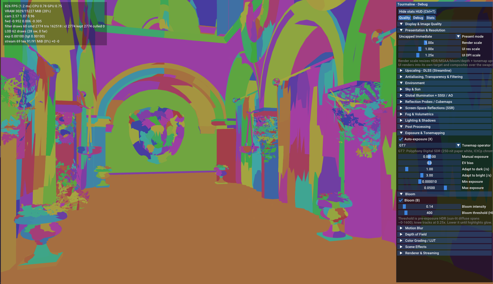
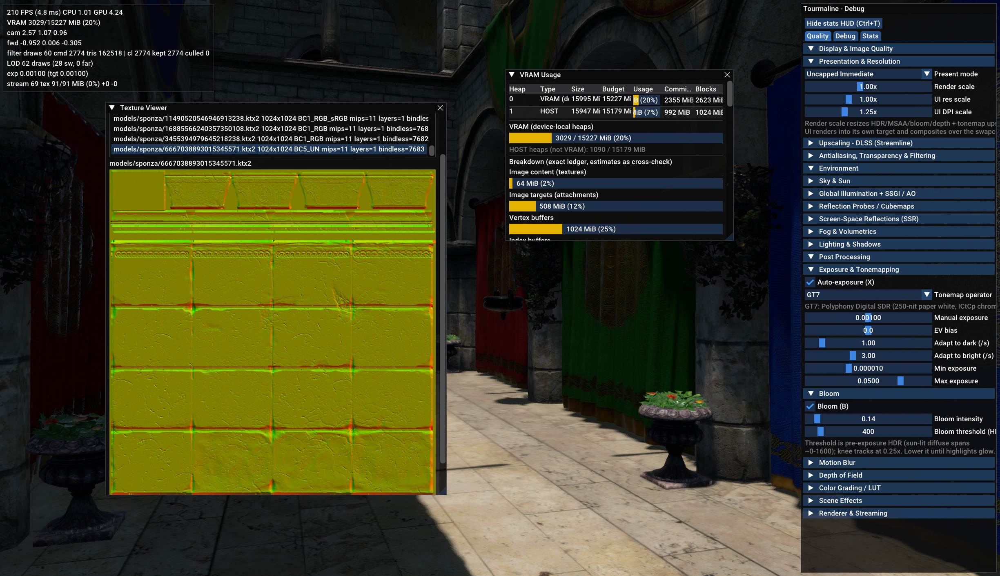

# Tourmaline

[](https://github.com/striker-samuel/tourmaline/actions/workflows/ci.yml)
[](https://github.com/striker-samuel/tourmaline/actions/workflows/tests.yml)

<picture>
  <source media="(prefers-color-scheme: dark)" srcset="branding/tourmaline-logo-horizontal-dark.png">
  
</picture>

**A rendering and content framework for C++20 applications, built on Vulkan 1.3.**

Tourmaline provides an opinionated GPU-driven renderer, a scene and asset pipeline, and the runtime infrastructure needed to bring authored content into native applications.

**Bring your own code.** Tourmaline doesn't prescribe a gameplay framework, ECS, scripting language, or application architecture. Write your application logic in C++, own your objects and their lifetimes, and use the parts of Tourmaline that make sense for your project.

Scenes are authored through a human-readable `.tour` command format with references and non-destructive overrides. Project recipes cook source assets into packaged `.pak` archives and generate a C++ `project.h` catalog, allowing applications to reference content through stable, typed identities rather than hardcoded file paths.

Tourmaline includes a Vulkan render graph, GPU-driven mesh rendering, clustered Forward+ lighting, animation and audio runtime services, content tooling, and an experimental editor.

The framework is under active development. APIs and asset formats are evolving, and several subsystems remain experimental.

## Highlights

- **Vulkan renderer:** Custom resource management, bindless descriptors, render graph, GPU synchronization, and HLSL shaders compiled to SPIR-V with DXC.
- **GPU-driven geometry:** Hierarchical-Z occlusion, GPU culling/filtering, meshlets, LOD chains, skinning, and geometry/texture streaming paths.
- **Lighting and effects:** Clustered Forward+ lighting; directional, spot, EVSM, and experimental deferred shadows; SSR, ambient occlusion, volumetrics, exposure, bloom, depth of field, motion blur, and SMAA. Optional DLSS-SR/Reflex integration is available on supported Windows/NVIDIA setups.
- **Authored worlds:** A Maya-inspired, text-based `.tour` scene overlay with references, overrides, editable nodes, and replayable operations. `.tourAnim` provides skeletal clips.
- **Content as code:** `Project.exe` resolves `.tourrecipe` builds, cooks and verifies multiple `.pak` files, publishes a `.tapp` runtime manifest, and generates a typed, `constexpr` `project.h` catalog of persistent asset IDs.
- **C++-first runtime:** Scene loading by asset ID, additive scene instances, asset prefetch, typed generational handles for mesh instances/animators/audio emitters, and scene-aware spatial audio. Game code owns the gameplay objects.
- **Editor and offline tools:** An ImGui scene editor plus command-line import, cooking, GI baking, packaging, asset inspection, and debugging tools. Jolt Physics is vendored and tested; engine-level rigid-body/collider integration is still in progress.

## Screenshots

GPU-driven meshlet debug view:



Renderer inspection and debugging panels:



*These captures use external demonstration assets. The full Sponza scene is not shipped in this repository.*

## How it fits together

Tourmaline separates **authoring**, **content builds**, and **game execution**. Content does not need to be cooked by launching the editor.

```text
Source assets (glTF / textures / WAV)     Scene edits (.tour / .tourAnim)
                    \                      /
                     v                    v
                     Import / asset database
                               |
                  Project.exe + .tourrecipe
                  (resolve, cook, bake, pack)
                               |
                   +-----------+-----------+
                   |                       |
            project.h                  .tapp + .pak
       typed C++ asset IDs       manifest + cooked archives
                   |                       |
                   +-----------+-----------+
                               |
                   Native C++ game / App host
                               |
                      Vulkan renderer
```

A checked-in `.tourrecipe` declares entry scenes, package ownership, cross-pak dependencies, and GI/cubemap bake switches. The pipeline resolves those dependencies, validates outputs, and publishes content-addressed pak files with a runtime manifest. Stable content IDs come from the project's asset database and asset GUIDs, rather than being derived from paths.

The generated `project.h` contains typed asset keys, a compile-time asset table, a catalog fingerprint, and generation metadata. The catalog and deployed manifest can be checked for identity mismatches. Catalog refresh, forced restamping, content cooking, and executable compilation are separate build operations.

### Example: code refers to assets, not filenames

```cpp
#include "project.h"

static_assert(project::Contains(project::EntryScene));
static_assert(project::Contains(project::textures::stone));

const auto scene = project::EntryScene;    // typed, stable asset key
```

For a complete, compilable example with multi-pak textures and scene-authored audio, see [`samples/04_project_game`](samples/04_project_game). `ProjectScenes` provides ID-based scene replace/additive-load/remove operations; the application host maps those keys to published pak content.

## Getting started

### Requirements

- **Windows x64:** Visual Studio 2022+ with MSVC C++ tools, the Vulkan SDK, CMake, Ninja, and Git.
- **Linux x64:** Ubuntu 24.04 with GCC 14 is the verified configuration, plus the required Vulkan/SDL development libraries, CMake, Ninja, and Git.
- **Both:** KTX-Software **4.4.2** installed separately. The dependency installers do **not** install KTX-Software or the Windows Vulkan SDK.
- **Windows recommendation:** Use the official **Embree 4.4.1 prebuilt package**; compiling the vendored Embree source with MSVC has triggered compiler internal errors in the tested configuration.

The detailed OS package lists, KTX build/install commands, and Embree setup are in [the existing build guide](AGENTS.md) and the repository's [CI workflow](.github/workflows/ci.yml).

### 1. Clone and install pinned dependencies

```bash
git clone --recursive https://github.com/striker-samuel/tourmaline.git
cd tourmaline
```

Windows (PowerShell):

```powershell
powershell -NoProfile -ExecutionPolicy Bypass -File .\install_dependencies.ps1
```

Linux:

```bash
./install_dependencies.sh
```

The scripts fetch the separately pinned/vendored dependencies into `external/`. Install KTX-Software first or before configuring; on Windows, install the Vulkan SDK and obtain prebuilt Embree as described above.

### 2. Configure and build

**Windows — Developer PowerShell for Visual Studio:**

```powershell
$env:KTX_ROOT = "$env:USERPROFILE\ktx"
cmake -B out/build/x64-Release -G Ninja -DCMAKE_BUILD_TYPE=Release `
  -DEMBREE_PREBUILT_DIR="$env:USERPROFILE\embree-4.4.1" .
cmake --build out/build/x64-Release --target App Editor EditorLauncher Project
```

Paths are examples; set `KTX_ROOT` and `EMBREE_PREBUILT_DIR` to your installations. The Visual Studio **IDE** can use the Ninja configuration, but the Visual Studio **CMake generator** is intentionally unsupported.

**Linux — Ubuntu 24.04/GCC 14 (after installing system packages and KTX):**

```bash
CC=gcc-14 CXX=g++-14 cmake -B out/build/linux-Release -G Ninja \
  -DCMAKE_BUILD_TYPE=Release .
cmake --build out/build/linux-Release --target App Editor EditorLauncher Project
```

All builds are out-of-source and use **Ninja**.

### 3. Cook and run the bundled C++ game sample

The repository includes a small project with checked-in glTF geometry, a texture, a WAV sound, a `.tour` scene, and a `.tourrecipe`. Unlike the larger Sponza demo, it does **not** require an external content store.

```bash
# Replace <build-dir> with out/build/x64-Release or out/build/linux-Release.
cmake --build <build-dir> --target GameProject_paks  # cook + publish content
cmake --build <build-dir> --target GameProject       # compile the game and catalog
```

Run the resulting `GameProject.exe` (Windows) or `GameProject` (Linux) from the build output directory. The sample finds its `.tapp` manifest alongside the executable and loads the published paks. The content build is explicitly **on demand**, not an implicit side effect of compiling a game.

The standalone viewer can also launch a cooked archive or project manifest:

```text
App --pak <path-to-file.pak>
App --project <path-to-file.tapp>
```

The viewer requires cooked content; there is no ready-to-run Sponza pak in a fresh checkout.

### 4. Open the editor

```text
EditorLauncher                 # project picker
Editor --project <project-dir> # direct launch
```

The editor supports scene inspection, authored `.tour` changes, references and overrides, gizmos, material/light editing, audio-source nodes, and cook operations. It is actively evolving and uses a simpler preview renderer than the main application path.

### 5. Run tests

```bash
cmake --build <build-dir>
ctest --test-dir <build-dir> --output-on-failure
```

The CMake suite currently registers **52 tests**. Five tests create a Vulkan device/window and need a working local graphics setup; hosted CI excludes those five while running the CPU-capable tests on Windows/MSVC and Ubuntu 24.04/GCC 14. Building on Linux is CI-tested, but interactive rendering is primarily verified on the author's Windows GPU configurations.

## Engine and gameplay boundary

Tourmaline is opinionated about its **rendering and content infrastructure**, not about how games must organize their gameplay code. It does not mandate an ECS or scripting language.

- **Assets** are shared, persistent resources addressed by generated catalog keys.
- **World-owned runtime objects** use typed generational handles, including mesh instances, animators, and audio sources.
- **Gameplay objects** are ordinary application-owned C++ structures or whatever higher-level architecture the game chooses.

An animator can play, crossfade, pause, resume, and adjust speed on a loaded skeletal clip. Current limitations include one rendered skeletal pose per owning cluster even when multiple animator states exist. Likewise, Jolt is present as a pinned dependency and standalone physics test; full authored rigid-body integration is not yet a finished game feature.

## Content and authoring formats

| Format | Purpose |
|---|---|
| `.tour` | Human-readable scene edits layered on source content: references, node changes, overrides, and authoring state |
| `.tourAnim` | Skeletal animation clips with joint/channel tracks |
| `.tourrecipe` | Entry scene, bake policy, pak ownership, dependency edges |
| `project.h` | Generated, typed C++ content IDs and build/catalog metadata |
| `.tapp` | Generated runtime manifest for published paks, entry scene, and content IDs |
| `.pak` | Verified, compressed or directly packed runtime resources |

The importer handles glTF/GLB and derives optimized geometry, LOD chains, meshlets, materials, and animation data. Cook/bake stages produce renderer-specific assets, while package assembly publishes relocatable content-addressed archives. Sound assets can be referenced through persistent IDs and used by authored or dynamically spawned audio emitters.

See [`docs/project_scenes.md`](docs/project_scenes.md), [`docs/audio_source.md`](docs/audio_source.md), and [`docs/entities_and_animators.md`](docs/entities_and_animators.md) for the implemented runtime model.

## Current limitations

Tourmaline is still a research-and-development engine. In particular:

- **No API or asset-format stability guarantee.** Breaking changes can require recooking assets; legacy format readers are not a standing commitment.
- **Terrain and GI are experimental.** Heightfields, placement, baked probes, and volume GI work for development scenes but are not production-hardened; visual defects or incomplete bakes are possible.
- **The editor is not a complete DCC replacement.** It has custom scene-authoring workflows, but its viewport is not identical to the full game renderer.
- **Runtime systems are intentionally scoped.** Some asset kinds remain scene/cluster-internal; multiple independent animated instances do not yet have independent rendered palettes within one cluster.
- **Jolt integration is incomplete.** The dependency and isolated simulation tests are present, not a full scene-driven physics runtime.
- **USD/Omniverse integration, renderer-pairing remasters, and a cinematic timeline format** are architectural ideas, **not shipped features** of this repository.

If you need a stable, fully supported production engine today, treat Tourmaline as experimental.

## Repository map

```text
engine/     Vulkan renderer, RHI, render graph, scene/runtime data, shaders
app/        Host application, runtime project/scene/audio facades, pak viewer
editor/     ImGui world editor and launcher
tools/      Import, Project, Cook, Pak, GI baker, artifact database, utilities
samples/    Rendering samples and the standalone GameProject example
tests/      CTest suites (CPU and GPU-dependent)
branding/   Logo and icon assets (editable SVG sources + raster exports)
cmake/      Shader compilation and project/host CMake helpers
docs/       System notes, contracts, migration records, build guidance
external/   Pinned submodules and fetched third-party dependencies
```

## Documentation

- [`AGENTS.md`](AGENTS.md) — build/test commands and development conventions.
- [`docs/project_guide.md`](docs/project_guide.md) — architecture overview and extension seams.
- [`docs/editor_tour_and_context.md`](docs/editor_tour_and_context.md) — `.tour` authoring and replay model.
- [`docs/project_scenes.md`](docs/project_scenes.md) — ID-based scene loading and asset ownership.
- [`docs/entities_and_animators.md`](docs/entities_and_animators.md) — typed runtime handles and animation.
- [`docs/audio_source.md`](docs/audio_source.md) — authored audio sources and sound content.
- [`docs/shader_library_design.md`](docs/shader_library_design.md) — project HLSL shader libraries, material instances, and 32-bit userdata (Phase A — the userdata transport + lit-hook seam — implemented; the ProjectLit family is the follow-up).
- [`docs/artifact-db-funnel.md`](docs/artifact-db-funnel.md) — ongoing artifact pipeline redesign notes (not all sections are implemented).
- [`THIRD_PARTY_NOTICES.md`](THIRD_PARTY_NOTICES.md) — vendored dependencies and redistribution notices.

## Development and licensing

Tourmaline is developed as a personal project. Development has been assisted by AI coding tools for implementation, debugging, tests, and documentation; architectural review and final decisions remain with the project author.

## License

**Tourmaline is free for independent creators and organizations with less than
USD $10 million in worldwide annual corporate-group revenue.** You can use the
engine to build and sell games, keep your gameplay code and private engine
modifications closed-source, and distribute completed games without engine
royalties or per-copy fees.

Organizations with **USD $10 million or more in corporate-group annual revenue**
need a separate **Tourmaline Commercial License** before new development using
Community-licensed Tourmaline releases. Parent companies, subsidiaries, and
commonly controlled entities count together; assigning development to a smaller
affiliate or contractor does not avoid this rule. Ordinary independent publishing
and non-controlling financing do not, by themselves, make an eligible studio
ineligible.

| Worldwide corporate-group annual revenue | Licensing |
| --- | --- |
| Below $10 million | Free Community License |
| $10 million to below $50 million | Commercial — illustrative $5,000/year |
| $50 million through $250 million | Commercial — illustrative $15,000/year |
| Above $250 million | Negotiated enterprise agreement |

Commercial prices are **proposed starting prices**, not a binding offer. A
separate signed agreement is required. See
[COMMERCIAL-LICENSING.md](COMMERCIAL-LICENSING.md).

**Your games remain yours.** Neither Community nor the proposed Commercial model
requires publishing private changes to the engine. The Community License provides
perpetual royalty-free distribution and maintenance rights for lawfully released
End Products, including bug fixes, platform/security updates, and eligible
Tourmaline maintenance patches. A Commercial License should expressly preserve
those same rights after its term ends. Neither model provides indefinite
technical support or unlimited feature upgrades.

The license is **source-available, not OSI-approved open source**. Community
rights depend on developer eligibility. See the full
[Tourmaline Community License 1.0](LICENSE.md).

**Existing MIT rights are preserved.** Tourmaline versions and source copies
previously published under MIT remain under MIT, including for commercial use.
The historical MIT license and the Packt scene-format attribution are preserved
in [LICENSE-MIT-2026.txt](LICENSE-MIT-2026.txt). Third-party libraries, tools,
assets, and binaries continue under their own terms; see
[THIRD_PARTY_NOTICES.md](THIRD_PARTY_NOTICES.md). Do not assume that every file
in the repository is relicensed under Tourmaline Community.
